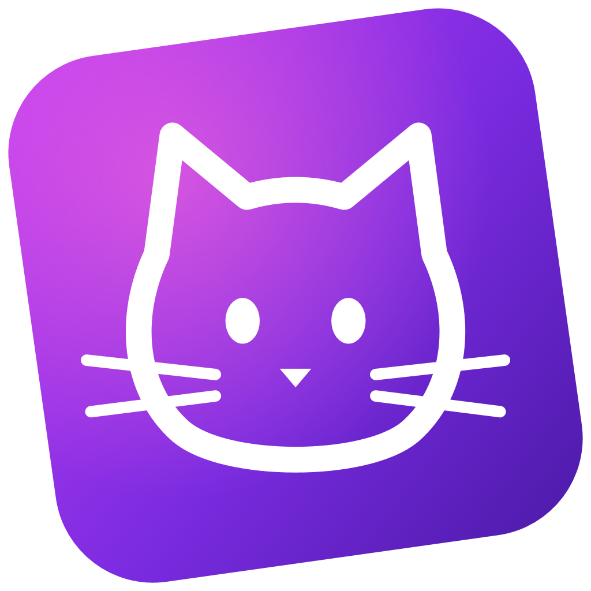

<div align="center">



# Xyllostrap

**A custom Roblox bootstrapper, forked from [Fishstrap](https://github.com/fishstrap/fishstrap) (itself a fork of [Bloxstrap](https://github.com/bloxstraplabs/bloxstrap)).**

[Download the latest release](../../releases/latest)

</div>

## Download

1. Go to the [Releases](../../releases/latest) page.
2. Download `Xyllostrap.exe`.
3. Run it. You **don't** need .NET installed, because everything is bundled in the exe.

Windows may show a SmartScreen warning because the exe isn't code-signed. Click **More info → Run anyway**.

## Features

Everything Fishstrap does, plus:

- **FastFlag templates**: one-click widget tiles on the FastFlags page. You can apply them, remove them, edit them, delete them, or save your own from your current flags.
  - **Potato Graphics**: the lowest settings for maximum FPS, with a grey sky.
  - **Rivals**: a grey sky, with Roblox's UI transparency set to 3.
  - **Competitive / No Clutter**: no shadows, grass or post-processing, but textures stay sharp.
  - **Max Quality**: the best looking settings for strong PCs.
- A purple Xyllostrap theme with smooth window and page animations.
- A new cat logo.
- No auto-updating to upstream Fishstrap.

> Roblox only accepts FastFlags from its [allowlist](https://devforum.roblox.com/t/allowlist-for-local-client-configuration-via-fast-flags/3966569), so some flags may have no effect.

## Building from source

You need the [.NET 8 SDK](https://dotnet.microsoft.com/download/dotnet/8.0) (only to build, not to run).

```powershell
dotnet publish .\Bloxstrap\Bloxstrap.csproj -c Release -r win-x64 --self-contained true -p:PublishSingleFile=true -p:IncludeNativeLibrariesForSelfExtract=true -p:EnableCompressionInSingleFile=true -o publish
```

The exe will be at `publish\Xyllostrap.exe`. GitHub Actions also builds it on every push. See the **Actions** tab.

## Credits

- **Code:** Xyllo, Claude
- **Feature ideas:** Xyllo, Timmy
- **Special thanks:** Timmy, Claude
- Built on [Fishstrap](https://github.com/fishstrap/fishstrap) and [Bloxstrap](https://github.com/bloxstraplabs/bloxstrap). Thanks to all of their contributors.

## License

MIT. See [LICENSE](LICENSE) (Fishstrap) and [LICENSE.Bloxstrap](LICENSE.Bloxstrap).
Xyllostrap is not affiliated with Roblox, Fishstrap or Bloxstrap.
